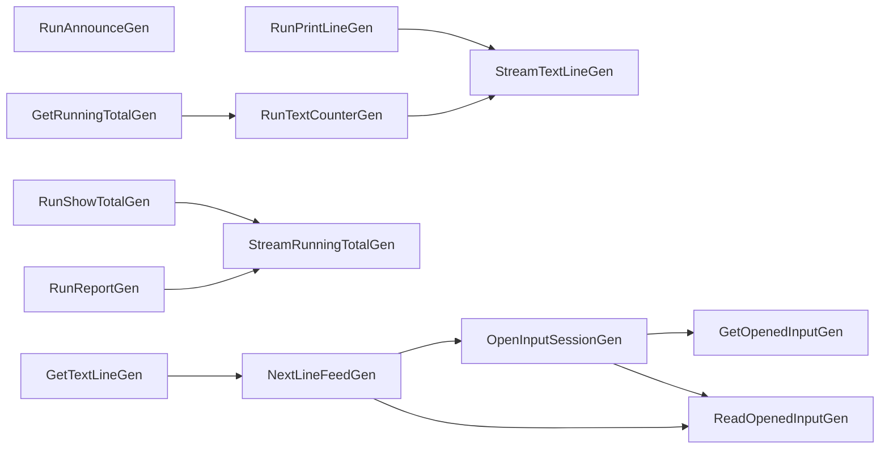

# Python LSP 后端构建指南

这份指南说明怎样把网页里的源码编辑接到框架编译器。以 `LinesDemo` 为例，`node "Reprot"` 能通过 Haskell 类型检查，gen 却能指出这个 workflow 目标没有注册。网页的目标是在保存后把这条诊断送回对应版本的源码。输入过程中的 Haskell 补全、悬浮类型和跳转可单独接入 HLS。

| 接口归属 | 实现状态与用途 |
| --- | --- |
| 框架 SDK，已实现 | `effect-codegen compiler Namespace` 检查业务源码，按需更新 `Generated/{Assets,Effects,Handlers,Prototype,Program}.hs`和 `Generated/Workflow.json`。已编译的业务程序支持 `--structure`，核对输入后打印静态结构，无需运行业务 handler。 |
| 框架 SDK，AST 读取已实现 | `effect-codegen ast Namespace` 只加载 `AST.hs`、`Workflow/*.hs` 和可选的 `Hanging.hs`，不读注册与 handler，不写 Generated。输出原样结构（具名绑定、源码范围）、规范形式与 `NodeId`、每个节点化简自哪些源码路径、Hanging 挂载的两种坐标、结构诊断和所读源码文件的 MD5（JSON）。完整生成成功时把同样内容写入 `Generated/Workflow.json`：网页打开时直接读它，用 Python 的 `hashlib.md5(data.replace(b"\r\n", b"\n"))` 核对 `sources`（CRLF 先换成 LF），一致就无需运行 SDK；文件缺失表示尚未生成，MD5 不同表示 AST 已改、需要重新生成，可先用 `ast` 显示当前结构。已合入 `main`（[`5b86712`](https://github.com/cartesianc/algebraic-effect-sys-in-haskell/tree/5b86712)）。 |
| Effect 模板工具，已实现 | SDK 的 `read-effect` 从标准输入解析单条表达式，`read-effects Namespace` 查看本地注册列表。Python 的 `read`、`generate`、`inspect` 可在命令行使用。 |
| 框架 SDK，待交付 | `effect-codegen read Namespace` 提供带源码位置的声明 JSON；只读 `effect-codegen check Namespace` 提供语义检查及结构化结果。方法体占位 `agentic (Agentic "任务键")` 的导出和识别也待实现。 |
| Python 服务，已实现 | FastAPI 的 `GET /api/v1/test/` 可验证 HTTP 服务已启动。[启动说明](README.md) |
| Workflow 缓存，已实现 | `GET /api/v1/console/namespaces/{ns}/workflow` 核对绑定工作树中的源码指纹，返回 `missing`、`stale` 或 `fresh`。后两者附生成时的完整报告。 |
| Workflow 优化，已实现 | `POST /api/v1/console/namespaces/{ns}/workflow/optimize` 在绑定工作树执行只读的 `ast`，返回当前规范树和结构诊断。源码加载失败时返回 422 及 GHC 原文。两个接口均需要获准的 Origin，支持只有 AST.hs 的命名空间。 |
| Python LSP，待实现 | WebSocket `/api/v1/lsp` 和下文全部 `framework/*` 消息。Python 负责文件、版本、索引、编辑和诊断投递。可选 HLS 负责编辑中的 Haskell 反馈。 |

本文和提案均以框架 `main` 的 `ed5273d` 为基线；AST 的规范形式、`chain` 写法和 `ast` 命令自 `main` 的 [`5b86712`](https://github.com/cartesianc/algebraic-effect-sys-in-haskell/tree/5b86712) 起可用，文中的 `NodeId` 按规范形式书写。每份快照同时记录业务工作区的 revision 和实际分析所用的 SDK revision，网页可据此判断图、诊断与编辑预览对应哪一版源码。[框架基线](https://github.com/cartesianc/algebraic-effect-sys-in-haskell/tree/ed5273d) · [协议与交付范围](PROPOSAL.md)

## 代码长什么样

编辑端通过 `/facade` 调 SDK 的 `read-effects` 解析手写声明。分析端默认通过 `/gened` 在磁盘的 Generated 目录读取 Haskell，使用 tree-sitter-haskell 建立模块、定义与同名引用索引。这里可以审阅上一次生成的代码，即使当前声明已经变更、当前 gen 失败，或没有发布快照。两端的接口与写入版本规则见 [启动与接口说明](README.md)。

生成图通过 `/plan` 读取磁盘上的 `Generated/Prototype.hs`。`chains.parents` 描述 Excu 与 Scoped 的消费关系，`branches` 描述锚点旁的生产步骤、资产及接收方。对闭包模型的生成产物，`Generated/Program.hs` 的 `compiledReactions` 给出资产发布后实际运行的节点和作用域，`compiledStatic` 给出可按请求运行至结束的来源。LSP 结合具体方法的读点描述取值方式，同一条关系可以同时表示触发和读取历史。旧生成文件保留其原型能确认的关系。[SDK 的闭包模型](https://github.com/cartesianc/algebraic-effect-sys-in-haskell/blob/00e3b4b/docs/NEXT_STAGES.md#closure-model)

普通资产可由锚点的成功输出发布。Handler 的 `require @T` 优先读取本次捕获或最新值。从 SDK `b1d0b23` 起，并行分支还声明自己可能发布的资产。对于普通读取，若兄弟分支具备发布机会，图用 `await` 表示缺值时可以等待；顺序读取、作用域资源以及缺少并行发布证据的读点沿用 `latest`。等待是否实际发生取决于读取时值是否就绪、发布分支是否仍在运行。[SDK 的等待规则](https://github.com/cartesianc/algebraic-effect-sys-in-haskell/blob/4fc49fd/docs/EFFECT_GRAPH.md)

`lifelong` 内的触发条件和回调如何取值可以同时显示。LinesDemo 中，`TextLine` 每次发布都触发 `PrintLine` 和 `TextCounter`。前者的 `require @Line` 读取本次交付（`delivered`），后者的 `stream @Line` 读取截至本次的历史（`history`）。`lifelong` 外，对持续资产的 `requests` 可以运行来源至结束，之后的取值方式由 Handler 决定。

当前工作树的顺序组合写作 `chain [node "Report"]`。SDK 在 Console 快照中将它导出为 `workflow.kind = "Chain"`，Python 原样传递 `kind` 和有序的 `children`。

下面是 `LinesDemo/Handlers.hs` 中的手写方法。注册声明了驱动它的资产，方法体给出了具体的读法。

```haskell
instance CountTextLayer m => CountTextHandler m where
  countText = do
    seen <- stream @Line
    rawoutput [show (length seen), show (sum [length text | Line text <- toList seen])]
```

`TextCounter` 和 `PrintLine` 都声明 `streams "TextLine"`，每次交付驱动它们所在的单元。`printLine` 用 `require @Line` 读取本条，`countText` 用 `stream @Line` 取得固定的 `Flow Line`。在 `x :> xs` 中，即使来源已经发布了下一行，`x` 仍是本次选中的交付。`xs` 是同一会话在这次交付之前发布的值，最近的在前。遍历这份前缀不会请求下一行。SDK 根据 `countText` 的调用在生产 Context `LineParser` 上记录 `effectHistory = True`。[LinesDemo 的 handler](https://github.com/cartesianc/algebraic-effect-sys-in-haskell/blob/ed5273d/demo/LinesDemo/Handlers.hs)

来源 `nextLine` 从 `InputFile` 取出路径，用 `Control.Monad.Catch` 导入的 `bracket` 打开文件并登记释放函数 `liftIO . hClose`。每次 `rawemit` 一行，挂接的 `parseLine` 用 `rawinput` 取得单元素列表。文件成功打开后，来源可以在 EOF 调用 `streamEnd` 时、逐条解析失败传播出来时或被取消时退出。这三条路径都会释放句柄。生成的 `NextLineLayer` 提供 `MonadMask`、`Emits` 和 `StreamEnds`。`CountTextLayer` 提供 `Streams Line m` 和 `EndsStream m`，消费方可以用 `endStream` 退出本订阅。`closeInput` 是 `InputSession` 的 scope 回调，它读取路径并打印关闭消息。上下文页分别定位 `hClose` 与 `closeInput`。[生成的 Layer](https://github.com/cartesianc/algebraic-effect-sys-in-haskell/blob/ed5273d/demo/LinesDemo/Generated/Effects.hs) · [手写来源与 scope 回调](https://github.com/cartesianc/algebraic-effect-sys-in-haskell/blob/ed5273d/demo/LinesDemo/Handlers.hs#L40-L57)

## 目录与职责

`webapp/` 放浏览器客户端，`server/` 放 Python 后端。框架根目录由后端配置，包含 `hie.yaml`、`cabal.project`、`sdk/` 和 `demo/<Namespace>/`。生成器和结构查看程序以选定的框架根目录为工作目录。Python 服务从 `server/` 启动，以便读取 `config.toml`。

```text
server/
├── README.md、PROPOSAL.md、LSP.md
├── pyproject.toml、poetry.lock、.python-version
├── config.toml
└── src/effect_server/
    ├── config.py
    ├── http/
    │   ├── __init__.py          ASGI 入口、应用生命周期、路由发现
    │   ├── exception/、log/     HTTP 异常和日志
    │   └── router/
    │       ├── test.py          现有 GET /api/v1/test/
    │       ├── console.py       注册快照、工作流报告、编译和执行
    │       └── lsp.py           规划：WebSocket 握手与收发
    └── lsp/                     单条 Effect 工具已接通，其余按阶段落地
        ├── session.py           消息路由、保存回执、发布诊断
        ├── documents.py         读写工作树、版本、应用编辑
        ├── __main__.py          已实现：本地模板 CLI
        ├── framework.py         已实现：同步 SDK JSON 调用。会话调度随后接入
        ├── validation.py        运行检查、归类诊断、判定快照是否可发布
        ├── context.py           按实体查询定义、引用和上下游
        ├── project/             model.py 读写两端共用的模板模型，index.py 定义与引用
        ├── analysis/            aftergen：模板源码 → 结构化模型
        │   ├── read.py          已实现：单条 EffectSpec 与命名空间注册列表
        │   └── impact.py        使用模型与 Prototype 比较两个版本的变化
        ├── agent/               context.py、prompt.py 提供书写上下文；runner.py 预留
        ├── runtime/
        │   ├── workflow.py      读取生成的工作流报告、校验指纹和运行只读 AST 优化
        │   ├── snapshot.py      保存每个命名空间最近一次成功的结构快照
        │   ├── scope_tree.py    显式 scope 节点与关系
        │   ├── effect_graph.py  方法图及可渲染的关系
        │   └── mock.py、trace.py 预留，不注册请求
        ├── codegen/             beforegen：结构化模型 → 模板源码补丁
        │   ├── plan.py          JSON 变更规格、生成预览和补丁
        │   ├── effect.py        已实现：单条效果注册的模板生成及读回核对
        │   ├── handler.py       实例骨架、方法体与委派占位
        │   ├── asset.py         资产契约与业务表示类型
        │   ├── ast.py           具名分支与工作流组合
        │   ├── hanging.py       中间件挂载声明
        │   └── scaffold.py      组合各生成器，新建命名空间并预览 Cabal 片段
        └── hls.py               可选的 Haskell 编辑服务
```

`http/router/lsp.py` 拟提供 `/api/v1/lsp`，校验 Origin 并将连接交给 `session.py`。每条 WebSocket 文本消息承载一个 JSON-RPC 对象。`session.py` 调用文档、校验、查询和生成模块。`framework.py` 统一启动和回收 SDK 工具。各模块复用这一个工具入口。

**首批落地范围。** 按“保存一份源码，收到对应版本的诊断”这条路径创建文件。其余目录随对应功能落地，mock、trace 和 agent runner 先在上图保留位置。

| 位置 | 第一条保存链路的职责 |
| --- | --- |
| 框架仓库的 `sdk/Framework/Gen/Main.hs`、`sdk/Framework/Gen.hs` | 前者分派拟新增的 `check Namespace`，后者把 `workflow` 已有的分析过程与写生成文件的步骤拆开。两个入口共用同一套 SDK 规则。 |
| 后端现有的 `config.toml`、`src/effect_server/config.py` | 配置可信框架工作树、允许连接的网页 Origin 和 SDK 工具路径。 |
| 后端的 `http/router/lsp.py`、`lsp/session.py` | 前者处理 WebSocket 握手，后者分派 `framework/read`、`framework/save`，先发送保存回执，再投递对应 revision 的诊断。 |
| 后端的 `lsp/documents.py`、`lsp/validation.py`、`lsp/framework.py` | 依次负责受限路径下的原子保存与版本、按版本调度检查和丢弃过期结果、调用并回收 SDK 进程。 |
| 网页仓库的 `app/page.tsx` | 首次验收从页面打开 `LinesDemo/AST.hs`，保存修改，分别展示保存状态与框架诊断。 |

从框架根目录查实现时，可以从这三处进入。

- `demo/LinesDemo/` 下的 `Effects.hs` 声明效果，`AST.hs` 组合工作流，`Hanging.hs` 挂载中间件，`Handlers.hs` 实现处理器，`Types.hs` 定义业务类型。`Generated/` 由显式生成操作写入。
- `sdk/Framework/Gen.hs` 中的 `compileNamespace` 串起分析和写入。`sdk/Framework/Gen/Frontend/Source.hs` 的 `loadHandlers` 把候选 `Generated.Effects` 作为内存模块交给本次 GHC 会话。保存时的检查可以使用这份候选契约，显式生成时才将它写入磁盘。
- `sdk/Framework/Generated.hs` 处理业务程序的 `--structure`，`sdk/Framework/Prototype/Structure.hs` 将编译进程序的 Prototype 渲染成文本。

## 框架 LSP 的模块职责

### 模板的双向序列化

`codegen`（beforegen）与 `analysis`（aftergen）共用版本化的模板模型。写端根据模型生成或局部更新业务命名空间中的 `Effects.hs`、`Types.hs`、`Handlers.hs`、`AST.hs`、`Workflow/*.hs`、`Hanging.hs` 和入口 `Main.hs`。读端可以直接打开已有项目，从同一组源码恢复结构、引用和方法体，并附上源码范围。Haskell 解析与名字解析交给拟议的 SDK `read`，Python 负责组装网页和编辑器使用的模型。

例如，写端把契约名 `RunningTotal` 与元素类型 `Total` 写成 `Asset @Total "RunningTotal"`。读端在 `CountParser` 注册中读回这项声明，并把类型引用定位到 `LinesDemo.Types.Total`。预览补丁时先在临时副本完成这次往返，比较可编辑字段和已解析的引用，再交给 `validation.py` 做 SDK 语义检查。显式生成 `Generated/` 仍由 SDK 的 `workflow` 命令负责。

**当前可运行的单条注册。** 在框架仓库根目录执行以下 PowerShell 命令。示例使用相邻的 `server` 源码，输入和输出均为 UTF-8。读端用 GHC 解析 Haskell 语法，保留字段值和列表顺序。写端输出一条可放入 `effects` 列表的表达式，输出前将其重新交给读端，并与输入的 v1 模型比较。

```powershell
cabal build exe:effect-codegen
$sdk = cabal list-bin exe:effect-codegen
$env:PYTHONPATH = (Resolve-Path ../server/src).Path
$OutputEncoding = [Console]::OutputEncoding = [Text.UTF8Encoding]::new($false)
$cli = @('-m', 'effect_server.lsp', '--sdk', $sdk)
'EffectSpec {name="Archive", typing=Excu {handler=Just "archive"}, input="Root", demands=[requires "Receipt"]}' |
  python @cli read | python @cli generate | python @cli read
```

这条命令读回的文档如下。可选方法用 JSON 的 `null` 表示，`demands` 和 `handles` 按源码顺序排列。Middleware 的 `allEffects` 读为 SDK 定义的有序类别列表，写端输出显式列表。

```json
{
  "schemaVersion": 1,
  "effect": {
    "name": "Archive",
    "typing": {"kind": "Excu", "handler": "archive"},
    "input": "Root",
    "demands": [{"access": "requires", "contract": "Receipt"}]
  }
}
```

`inspect Namespace` 列出已保存的注册。字面量注册列表带有 GHC 的源码范围 `[起始行, 起始列, 结束行, 结束列]`（从 1 开始，右端不含，制表符按 GHC 列计算）。模块使用局部 helper 等协议外写法时，工具在受信任的工作树中用 GHCi 求值 `effects` 并标为只读。`inspect Namespace --name EffectName` 取出单个模型，可以交给 `generate` 生成独立模板。CLI 将结果写到标准输出。放入模块时，需要在该模块导入相应的 SDK 构造器、组合子与表示类型。

此阶段的字面量模型保存资产类型拼写。单条表达式没有模块导入环境，定义跳转、跨模块身份核对及完整组合规则留给后续项目级读取与检查。下面的 Runtime、编辑事务和 WebSocket 接口仍为设计。

### Runtime　展示静态 ScopeTree 与 EffectGraph

SDK 已计算 `compositionPrototype`、`compositionUnit` 和 `checkAssets` 的资产目录。目前 CLI 只持久化生成结果和私有缓存。拟议的只读 `check` 要从同一次分析导出这些事实，LSP 再与同一 revision 的源码位置关联。两张图与索引一起发布。检查失败时保留最近成功的图并标明旧 revision；首次失败时显示“暂无结构”。缺少手写 handler 时，按已完成的阶段显示声明和候选契约，标明“实现待补全”。

| 视图 | 来源与展示规则 |
| --- | --- |
| `scopeTree` | 读 `protoScopes`，以 open 方法身份为节点 ID，从 `protoScopeNames` 取显示名。保留根、唯一节点、全部直接父子边、层次和路径。布局支持多个根、孤立节点、共享子节点。候选顺序、相反顺序和未确定顺序作为单独的证据展示。最终父边已计入注册前提。直接父边取自 `scopeParents`。`scopeRelations` 返回祖先闭包，只适合查询祖先。 |
| `effectGraph` | 读 `protoGraph.graphMethods` 和 `graphReferences`。每个节点是方法，含身份、角色和所属 effect。每条直接引用边从调用方指向被调用方法。保留入口、各入口的 scope 路径与顺序证据，并保留 `methodBody` 的 `Empty / Call / Sequence / Choice / Recover`，以便查看分支和恢复。前端可按 effect 折叠显示，展开后仍能定位原始方法边。 |
| 动态数据 | 实际开启的 scope 实例、选中的发布和 close 时刻只在执行中产生。`runtime/trace.py` 与 `runtime/mock.py` 均预留，首版提供静态图查询。 |

**LinesDemo 默认工作流。** 在 `ast` 中，`Announce` 位于 `[0]`（源码写作 `chain [node "Announce"]`，规范形式消去单子项包装）。接下来的 `monitorLines` 位于 `[1]`，其中两个单元并行。一个单元处理每次 `TextLine` 交付，依序执行 `PrintLine` 和 `TextCounter`。另一个单元按 `RunningTotal` 交付执行 `ShowTotal`。`Report` 位于 `[2]`，在 lifelong 完成后执行一次。`TraceLine` 挂在 `monitorLines` 上，拦截类别为 `StreamKind` 和 `ScopedKind`。同模块导出的 `snapshotAst` 在这棵 AST 中没有挂载位置。[AST](https://github.com/cartesianc/algebraic-effect-sys-in-haskell/blob/ed5273d/demo/LinesDemo/AST.hs) · [Hanging](https://github.com/cartesianc/algebraic-effect-sys-in-haskell/blob/ed5273d/demo/LinesDemo/Hanging.hs)

**EffectGraph。** 下图的箭头逐条对应默认 Prototype 的 `graphReferences`，方向为调用方指向被引用的方法。`RunAnnounceGen` 也是可达节点，直接引用为空。[生成的方法图](https://github.com/cartesianc/algebraic-effect-sys-in-haskell/blob/ed5273d/demo/LinesDemo/Generated/Prototype.hs#L455-L527)



两条读 `TextLine` 的边都指向 `LineParser` 的 `StreamTextLineGen`（`ContextRequire`）。展开边时，把各自绑定的手写调用标为“当前值”（`printLine`）或“历史前缀”（`countText`）。订阅与会话来源取自 `protoWorkflow` 的 lifelong 计划，其中 `TextLine` 为 `Receive "LineFeed"`，`RunningTotal` 为 `ReuseOutput [[1,0,1]]`，即复用这个位置的 `TextCounter` 输出。`TraceLine` 的挂载取自 `protoDriving.drivingMiddleware`。这些关系在网页上分别标出其来源与含义。

**ScopeTree。** 默认图只有一个根 `OpenInputSessionGen`，显示名为 `InputSession`，父子集合都为空。其开启计划为 `RegistrationSingleton`，开启参数来源为空。下面节选拟议的 `framework/runtime` 响应，展示完整的 scope 节点以及方法图中两条读取边的编码。[生成的 ScopeTree 与开启计划](https://github.com/cartesianc/algebraic-effect-sys-in-haskell/blob/ed5273d/demo/LinesDemo/Generated/Prototype.hs#L528-L573)

```json
{
  "scopeTree": {
    "roots": ["OpenInputSessionGen"],
    "nodes": [{"id": "OpenInputSessionGen", "label": "InputSession", "parents": [], "children": []}],
    "layers": [["OpenInputSessionGen"]],
    "paths": [[], ["OpenInputSessionGen"]]
  },
  "effectGraph": {
    "nodes": [
      {"id": "RunTextCounterGen", "effect": "TextCounter", "role": "HandlerMethod"},
      {"id": "RunPrintLineGen", "effect": "PrintLine", "role": "HandlerMethod"},
      {"id": "StreamTextLineGen", "effect": "LineParser", "role": "ContextRequire"}
    ],
    "edges": [
      {"from": "RunTextCounterGen", "to": "StreamTextLineGen", "kind": "references"},
      {"from": "RunPrintLineGen", "to": "StreamTextLineGen", "kind": "references"}
    ]
  }
}
```

**历史与资源持有。** 固定视图按发布时间存储，`lastBinding` 对应业务端 `x :> xs` 的 `x`。在执行交接或计算 scope 开启参数时，这份视图只贡献当前 Binding 的生产身份。历史里的旧值仍可遍历，仅保存在历史中不会延长旧 scope 的使用期，也不会增加 ScopeTree 父边。若另一游标尚未领取旧交付，队列条目及其伴随绑定仍按该义务保留。来源停止且读者全部离开后会话释放历史，有发布时仍保留最新值。静态页面展示开启和读取计划，精确的资源释放时刻需要运行观测。AST 的 `NodeId` 也只在本次展开中有效，换 revision 后应重新解析具名定义。[Session 的视图与保留](https://github.com/cartesianc/algebraic-effect-sys-in-haskell/blob/ed5273d/sdk/Framework/Runtime/Session.hs#L286-L333) · [流式资源规则](https://github.com/cartesianc/algebraic-effect-sys-in-haskell/blob/ed5273d/docs/STREAM_LIFELONG.md)

`alternative` 的界面保留候选顺序。当前 `FileDemo` 的 `alternativeSource` 是共同的 `ReadFile`，选择位置为 `[-1]`，两个 case 按序为 `([0], "BlankText")` 和 `([1], "FilledText")`，分别通向 `WriteFirstLine` 和 `AppendLine`。两个 parser 依序尝试同一次原始输出；都未成功时按同一顺序查已有绑定，两者都可读就选第一项。缺值且仍有许可来源时才等待，来源耗尽后重读仍无值则报 `ContextNotInitialized`。许可来源取自 `protoSources` 在选择位置的读点：`FileDemo` 的 `[-1]` 对两个判定资产都是 `FromOwnChain`，即本次解析不出值时不等待。结构视图展示这张选择表与读点，实际选中哪一项属于运行信息。[FileDemo 的选择表](https://github.com/cartesianc/algebraic-effect-sys-in-haskell/blob/ed5273d/demo/FileDemo/Generated/Prototype.hs)

### 代码生成　将 JSON 变成业务源文件的编辑

拟议的 `framework/planEdits` 接收规格版本、namespace、基准 revision 和实体变更，返回逐文件 diff、基准指纹、待填方法与候选诊断。先按文件归并操作，资产和 effect 同时改同一个 Context 时合成一处编辑。LSP 生成的业务源码不写注释，只替换可定位的声明和必要的 imports，保留范围外的手写注释与自由方法体。显式 `framework/generate` 是另一个待实现的网页请求，底层调用现有 SDK 的 `workflow` 命令。

源码投影先区分三种结果。v1 范围内的声明可逐项读写。SDK 接受但超出 v1 的表达式可按求值结果只读展示，例如 `FacadeProbe/Effects.hs` 用 `where` 复用注册写法。违反 SDK 固定形式的 `Types.hs` 要显示 gen 诊断，例如手写 `instance Show T` 或使用 `Handle` 字段。完整文件文法见[提案第 2 节](PROPOSAL.md)。

| 生成器 | JSON 需要表达什么 | 对应业务源码 |
| --- | --- | --- |
| Effect | 名称、`EffectTyping` 变体及其专有字段、input、带 `requests / requires / streams` 的 demands。处理 handler、资产和 scope 等引用。 | `Effects.hs` 的注册及必要 imports。 |
| Handler | 目标实例和方法、从 SDK 推出的签名及能力、已有实现、申请编辑的方法体。多个 effect 复用同一 handler 时共用一份实现。 | `Handlers.hs` 中的 instance 和方法。类、Layer 及装配由 SDK 生成。 |
| 资产 | 契约名、唯一生产 Context、元素表示类型的身份及使用处拼写。多个契约可共用表示类型，每个 effect 内的读取须能路由至唯一契约。 | 例如 `Effects.hs` 写 `Asset @Total "RunningTotal"`，同时复用或创建 `Types.hs` 的表示类型，并补 parser 骨架。持续契约也注册元素类型，`Flow Total` 只出现在历史读取结果中。新建的 data/newtype 只有一个构造器，至少一个字段，字段写 `String`、`[String]` 或本模块表示类型，生成 `deriving (Eq, Show)`，读取也接受反序。 |
| AST | 模块、具名分支、引用和有序子项，支持 `node / chain / parallel / alternative / lifelong`。读回用 `effect-codegen ast` 比较规范形式：嵌套的同类 `chain`／`parallel` 拼平、单子项包装消去、空 `chain`／`parallel` 删除，写法不同但规范形式相同的两棵树执行相同。lifelong 的单元就是它的直接子项，alternative 的候选须是 node 且至少两个。同一直接子列表遵守 SDK 对裸 node 或子分支的齐次约束。 | `AST.hs` 及 `Workflow/*.hs`。保留具名绑定与复用位置。 |
| Hanging | 中间件 effect 与具名分支的定义身份，记录分支的全部挂载位置。 | `Hanging.hs` 中的 `hanging [middleware [node "TraceLine"] [monitorLines]]`。有效范围还受 `intercept` 限制，本例仅有 `StreamKind` 和 `ScopedKind`。 |
| 脚手架 | 命名空间与 Cabal executable 规格。 | 生成 Types、Effects、AST、Main、空 Handlers；Cabal 片段也进入补丁预览。 |

**委派以单个方法体为单位。** SDK 支持占位后，目标源码形态如下。当前 SDK 尚未导出这项能力。

```haskell
instance ReportLayer m => ReportHandler m where
  report = agentic (Agentic "LinesDemo.report")
```

LSP 按 namespace 与方法名保存任务说明，用 SDK 绑定的定义身份识别占位并关联任务键。拟议的 `framework/agenticContext {namespace, method}` 返回该方法的上下文和提示词，列出实际 Layer、每次绑定的资产路由、输入形状、可用 imports 和下游用途，供人审阅。LLM 调用和自动迭代留到后续；接入时，委派仅交回方法体文本，imports 由编辑侧管理。

规格缺少业务实现时，预览明确列出待完成方法。重复生成同一规格应得到空 diff，已有业务方法体只有被显式选中才进入补丁。

### 校验　给保存版本和候选补丁同一套检查

拟议的 `validation.py` 先检查 JSON 形状、引用和跨文件编辑冲突。在隔离副本应用整组补丁，用声明读取器和 handler 用法索引读回，与预期模型比较声明顺序、具名引用、每次挂载的位置和方法体。再用只读 `check` 对照 SDK 的注册和组合结果。涉及资产时，在同一编译上下文中核对契约名和解析后的 `TypeRef`，改写限定导入后也要重新核对。身份不符时拒绝应用。诊断携带来源、可用的位置和 revision。即使 agentic 占位可以定型，依赖其真实方法体的规则仍标为“等待填写”，可独立判断的其他错误照常报告。方法补齐并通过检查后才标为就绪。

`framework/applyEdits` 由 `documents.py` 执行。应用前在工作区写锁内复核整批文件指纹及 revision，任一文件冲突就返回需要重新预览。按文件原子替换。中途失败时核对已写文件并恢复仍属于本次编辑的内容，报告已恢复文件和仍有冲突的文件。重试前核对磁盘。全部完成后为这组编辑产生一个新 revision，重新检查并发布快照。这样一次“新增资产 + 修改 Context + 补 handler”的修改可以作为一个操作验收。成功的事务记录反向补丁，最近一次编辑的撤销也走同一事务。

### 获取信息　从实体返回带来源的上下文

`framework/context {namespace, revision, kind, key}` 读取该快照的正向和反向索引。返回定义、源码锚点、具名且有方向的关系、相关诊断与查询所用 revision。关系引用共享实体，可按 ID 继续展开。SDK 只能确定模块或定义时，返回已有精度；定义位置缺失时明确标注。方法实现和定义名的来源应在 GHC 前端求值前保留，资产目录目前提供的是起点。只读 `Prototype` 无法还原完整手写源码。

| 查询对象 | 应收集的上下文 |
| --- | --- |
| Handler | 手写 instance 与方法体、生成契约、签名、能力、全部绑定的 effect 和方法、读取资产及相关挂载。来源包括 `Unit.unitBindings`、`unitSignatures` 和 GHC 解析的 handler 源码。 |
| Effect | 注册、类别、input、demands、handler、产出契约、直接及反向方法引用、scope 与 AST 挂载。声明但未出现在当前可达方法图的 effect 也可查。 |
| AST 模块或分支 | 模块内具名定义、被引用位置、当前选中根中的挂载路径、子节点、链入口、scope 开启、读点和中间件挂载。同一分支可对应多个位置，备用导出要标明未挂载。 |
| 资产 | 契约名、唯一生产 Context 和 parser、表示类型在使用处的拼写和范围、已解析的内建种类或业务类型定义、各消费方的访问方式。业务类型可跳转至构造器及字段。依赖出错时保留原文和范围，将身份标为未解析。 |

查询 `RunningTotal` 应返回类型 `LinesDemo.Types.Total`、生产 Context `CountParser` 和 parser `parseTotal`。`ShowTotal` 通过 `streams` 持续执行，`Report` 通过 `requires` 有限读取，两个方法体都用 `require @Total`。默认的 `monitorLines` 内复用 `TextCounter` 的同次输出，lifelong 完成后的 `Report` 从会话读取保留的最新发布。默认 Prototype 也列出根级候选计划 `Derive "TextLine"`，UI 须标明计划所属范围。将 `ast` 改为 `snapshotAst` 并把 Hanging 目标同步改到 `snapshotAst` 后，需要显式请求 `RunningTotal` 才能在没有已启动会话时为 `Report` 取得交付。[两种会话计划与工作流读点](https://github.com/cartesianc/algebraic-effect-sys-in-haskell/blob/f36bb4e/demo/LinesDemo/Generated/Prototype.hs)

`String` 和 `[String]` 各按完整的 `TypeRep` 识别，注册中的 `FilePath` 与 `String` 同型。业务表示类型按当前编译单元、定义模块和本地声明名核对，补全和跳转以解析出的定义去重。`FacadeProbe` 的 `ReportBody` 和 `ReplyBody` 各有生产方，两者都跳到 `FacadeProbe.Types.Body`。生成的 Prototype 对二者均写 `SDK.typeRef @AssetTypes.Body`，在目标组件中重新取得身份。GHCi 分析时的单元标识只用于该编译上下文。[SDK 的类型身份](https://github.com/cartesianc/algebraic-effect-sys-in-haskell/blob/ed5273d/sdk/Framework/Language/Registration.hs) · [FacadeProbe 生成产物](https://github.com/cartesianc/algebraic-effect-sys-in-haskell/blob/d10d717/demo/FacadeProbe/Generated/Prototype.hs)

## 第一步　保存后检查 EDSL，发布静态快照

### 只读检查入口与工具环境

**SDK 还需提供两个只读子命令。** `read Namespace` 用 GHC 解析声明并取得引用的定义身份，向 LSP 提供源码形状、限定引用与范围，无需求值声明。`check Namespace` 复用生成器的候选契约、组合与类检阶段，导出语义结果和阶段诊断。两者都保留磁盘上的 Generated 文件与缓存。服务器的 `framework/read {uri}` 仅读取原文和指纹；`framework/model {namespace}` 才面向网页返回同一 revision 的源码模型，将可解析的声明和 SDK 已确认的关系分别标出。

现有 `workflow` 先由 `loadHanging` 定位挂载，`loadComposition / beginComposition` 求值声明并生成候选接口，随后依次经过 `renderEffects`、`loadHandlers / shapeHandlers`、`prepareComposition / completeComposition` 和 `checkAssets`。只读 `check` 拟复用这些步骤，在写文件前返回。候选契约可先与磁盘 `Generated/Effects.hs` 按统一换行比较。即使后续 Handlers 加载失败，也应报告已知的契约状态及到达的阶段；还未取得候选契约时标为“未知”。

**首版在进程边界接收失败。** `Frontend.Source.loadComposition` 启动 GHCi 并继承 stderr，拒绝声明时可能 `die` 或 `exitWith`。`loadHandlers` 和 `checkAssets` 中 GHC 可先打印诊断、再抛异常。因此 Python 并行读取两个输出流，同时等待退出。拟议的 `check` 成功时 stdout 输出一份 JSON 结果。失败时用退出码、可识别的诊断和 stderr 文本报告，启动失败、超时与用户代码错误分别处理。没有可信位置的消息展示在项目级。GHC 9.12.2 支持 `-fdiagnostics-as-json`。如后续接入，须分别配置 GHCi 和进程内 GHC 会话的诊断输出，逐行识别 JSON，并兼容混合的普通 stderr。将有范围的诊断按源文件与客户端位置编码转换。[GHC 9.12.2 诊断选项](https://downloads.haskell.org/ghc/9.12.2/docs/users_guide/using.html#ghc-flag--fdiagnostics-as-json)

在框架根目录准备项目匹配的 GHC、GHCi 和 Cabal，本地基线使用 GHC 9.12.2。在专用构建目录提前编译生成器。SDK 交付 `read` 和 `check` 后，用同一命令重新构建。下面以 PowerShell 为例。

```powershell
$toolBuild = Join-Path $env:LOCALAPPDATA 'effect-server/LinesDemo/dist-newstyle'
cabal build --builddir="$toolBuild" exe:effect-codegen
cabal list-bin --builddir="$toolBuild" exe:effect-codegen
```

实际部署按工作树及工具链区分目录。Python 记录构建成功后 `list-bin` 给出的绝对路径，每次分析或生成按 argv 直接启动该二进制。工具进程的 `PATH` 需能找到匹配的 `ghc`、`ghci`。其工作目录、包数据库和 `GHC_ENVIRONMENT` 必须与本次构建一致。可用同一构建目录的 `cabal exec` 启动常驻工具启动器，让子进程在该 Cabal 环境的有效期内继承变量。启动时校验包环境有效，不缓存已结束的 `cabal exec` 的临时环境文件。当前 CLI 发现缺少 `GHC_ENVIRONMENT` 时会自行经 `cabal exec` 重启。[Cabal 命令说明](https://cabal.readthedocs.io/en/stable/cabal-commands.html) · [Cabal 3.16 的临时环境管理](https://github.com/haskell/cabal/blob/cabal-install-v3.16.0.0/cabal-install/src/Distribution/Client/CmdExec.hs#L232-L259)

Windows 部署须在实际 ASGI worker 中支持 `asyncio.create_subprocess_exec`，能启动检查器并分别接收 stdout 和 stderr。[Python 平台说明](https://docs.python.org/3.13/library/asyncio-platforms.html#subprocess-support-on-windows)

### 网页保存与诊断

**只接入受信任的本地工作树。** 网页可以写 Haskell 源码，生成器随后会加载项目，`loadComposition` 还会启动 GHCi 求值声明。服务显式监听 `127.0.0.1`。WebSocket 握手在 `accept()`、分配会话和启动进程之前，把 `Origin` 的协议、主机、端口与配置的 webapp 来源精确匹配。例如开发时配置 `http://localhost:3000`，拒绝其他来源、缺失值和 `null`。现有 HTTP CORS 中的 `allow_origins=["*"]` 不会检查 WebSocket 握手。这个部署约定以单用户本机开发为前提。[Starlette CORS 实现](https://github.com/encode/starlette/blob/master/starlette/middleware/cors.py)

Python 响应 `initialize` 并返回 `{"capabilities": {}}`，随后接收 `initialized` 通知。自有网页通过 `framework/*` 消息读取、保存和接收诊断，编辑器自行维护未保存的文本。关闭时 Python 回复 `shutdown`，收到 `exit` 后释放会话。

**保存由一个请求完成。** 打开已有文件时，`framework/read {uri}` 从同一次磁盘读取返回文本及其字节指纹 `baseHash`。保存时网页发送 `framework/save {uri, version, text, baseHash}`，附带编辑器当前全文和上次读取或保存得到的指纹。`documents.py` 负责写入。

1. 只接受工作区内可编辑的手写业务源码。解析并解码 URI，检查 Windows 盘符、UNC、目录穿越、符号链接及 junction，拒绝显式 `..`、根外路径和 Generated 等受保护目标。对解析后的目标和父目录按路径组件检查归属。其他进程和文档消息也使用同一根目录约束。
2. 将同一路径的保存串行化。核对同一会话中的保存版本和写入前的磁盘指纹。冲突时返回错误，保留网页缓冲区供重新加载或合并。校验通过后在同目录写临时文件并原子替换，返回已保存版本和新指纹。浏览器只在当前编辑版本与回执版本相同时清除未保存标记。
3. 保存回执带上工作区 `revision`。Python 对受影响的命名空间调度一次 `check`。保存成功和分析完成分别反馈，分析报错时网页仍然显示该版本已保存。

**快速连续保存只保留最新工作。** 首版建议以 300 毫秒防抖、60 秒超时作为可配置起点，实际耗时按项目记录。一个工作区同时只运行一次框架分析，每个受影响的命名空间只排队最新版本。分析中的输入变更或超时时，终止并等待该任务的进程树（含 GHCi），回收完再运行下一项。Windows 可用 kill-on-close Job Object，POSIX 可用进程组。启动时记录 revision 和命名空间的磁盘输入指纹，发布前复核。若其他进程改了输入，丢弃旧结果并用新指纹重新排队。文件监视或指纹复核由 Python 在本地完成。

**显示诊断和契约状态。** 网页接收 `framework/diagnostics {namespace, revision, files, messages, contractState}`。只接受当前 revision 的结果，按命名空间整体替换标记，空结果清除旧错误。编辑器里仍有未保存的输入时，注明分析对应的已保存版本。契约不一致或磁盘文件缺失时显示“声明已变更，请生成接口”。最新检查确认一致时清除提示，包括用户撤回声明改动的情况。

同一轮只读检查成功后，`framework/runtime {namespace, revision}` 和 `framework/context {namespace, revision, kind, key}` 可读取该版本的静态图和索引。这个阶段只需 SDK 的结构化输出。检查失败时返回本次诊断，上一次成功的图保留自己的 revision。

## 第二步　显式生成与结构文本

网页发送 `framework/generate {namespace}`，后端校验已绑定的命名空间，调用预编译好的 `effect-codegen compiler Namespace`。生成与分析串行。生成器依次更新 `Generated/` 下的文件，内容未变的不重写。生成进程退出后重新读取磁盘上的文件。成功时重新运行只读检查；失败时可能已有部分文件更新，网页应报告失败、将结构标为过期并允许重试。新保存可以取消旧的只读分析，正在写文件的生成应等其结束。

`framework/structure {namespace}` 可选用已编译业务程序的 `--structure` 文本视图。显式生成后，在同一构建目录重建过期的 demo 二进制。核对退出码、源码指纹和 revision，输入不匹配时将文本标为过期。下面的命令今天即可在框架工作树中使用。

```powershell
cabal build --builddir="$toolBuild" exe:lines-demo
$demoBinary = cabal list-bin --builddir="$toolBuild" exe:lines-demo
& $demoBinary --structure
```

## 第三步　JSON 代码生成

先用 `LinesDemo` 验收局部修改，再接多文件创建。网页取得上下文、提交规格、预览补丁，在隔离副本中读回并检查，再应用到手写文件。SDK 支持 agentic 占位后可单独列出待填方法。业务方法填好后重新检查，最后由用户显式生成派生产物。

## 可选扩展　HLS 提供编辑中的 Haskell 反馈

当产品需要未保存缓冲区的 Haskell 类型反馈、补全或跳转时启用本节。HLS 独立运行，使用项目自己的 cradle。它看到的依赖是磁盘上的 `Generated/Effects.hs`，框架检查器使用的候选契约属于另一个 GHC 会话。

在框架根目录通过 stdio 启动 `haskell-language-server-wrapper --lsp`，让 wrapper 选择与项目 GHC 匹配的 HLS。管道消息按 UTF-8 字节数写 `Content-Length`，stderr 留给日志。

**协商能力并接管磁盘监视。** 启用 HLS 的会话在网页发送 `initialize` 时启动 HLS 并转发这一次初始化，将协商出的编辑能力返回网页。向 HLS 发出的请求使用后端绑定的项目根，并在具备监视实现后设置 `workspace.didChangeWatchedFiles.dynamicRegistration = true`。只有支持相对模式时才声明 `relativePatternSupport`。HLS 的标准编辑请求和诊断照常转发。[LSP 文件监视协议](https://github.com/microsoft/language-server-protocol/blob/gh-pages/_specifications/lsp/3.17/workspace/didChangeWatchedFiles.md)

- 收到 `client/registerCapability` 时，Python 取出针对 `workspace/didChangeWatchedFiles` 的条目，按注册 ID 安装 glob、相对根和创建／修改／删除过滤器。收到 `client/unregisterCapability` 时按 ID 移除。一个请求混有其他注册时，只转发浏览器应处理的条目，最后向 HLS 回复一次。
- `hls.py` 监视本地工作树。显式生成改写 Generated、外部编辑未打开的模块，都从磁盘事件中识别。合并重复事件，向 HLS 发送匹配其注册的 `workspace/didChangeWatchedFiles`。框架分析继续按自己的输入指纹和 revision 失效。已在编辑器打开的生成文件若展示旧文本，客户端同时重载只读模型，同步新的打开文档内容。
- `didOpen/didChange/didClose` 按接收顺序发给 HLS。HLS 维护未保存缓冲区。Python 记录版本和 dirty 状态，透传客户端与 HLS 协商的文本编辑。保存成功后由 Python 按协商选项向 HLS 发一次 `textDocument/didSave`。

**请求 ID 按连接方向管理。** 对每个目标连接分配独立的出站 ID。映射记录原发起方、原 ID 和待完成请求。收到响应后恢复原 ID 或唤醒后端自己的调用。浏览器的请求、本地 `shutdown`、HLS 发起的请求均按此处理，`$/cancelRequest` 同步翻译其中的 ID。通知不分配 ID，进程退出时结束相关的待处理请求。[LSP 基础协议](https://microsoft.github.io/language-server-protocol/specifications/lsp/3.17/specification/)

**断线和进程退出。** 接入初期用一个 Granian worker 保存会话。断线后保留 HLS 30 秒，持有随机会话令牌的原标签页可以重连。刷新时恢复客户端能力、有效注册和打开文档全文，再接收诊断。Python 对已初始化的 HLS 复用协商结果，协调关闭旧文档并按新全文重开。客户端能力或同步状态无法对齐时创建新会话。断线时结束挂起的旧请求。宽限期届满后发 `shutdown`、等待回复、发 `exit`，超时回收进程。HLS 崩溃时结束待处理请求，通知网页，活动会话可自动重启一次，由网页重发全文。连续失败时显示错误并允许手动重连。

HLS 诊断走标准 `textDocument/publishDiagnostics`，框架继续走 `framework/diagnostics`。若使用 Monaco，给两个来源分配不同的 marker owner。契约过期时给已有项目提示补上“HLS 当前按磁盘契约检查”，保留两边的诊断。生成后由文件监视器向 HLS 报告匹配的变更。[Monaco 标记接口](https://microsoft.github.io/monaco-editor/typedoc/functions/editor.setModelMarkers.html)

## 交付顺序与验收

以下用例从网页的正常入口验收。阶段 A 对应第一步，阶段 B 对应第二、三步，阶段 C 在成功快照上增加书写上下文和变更影响。运行观测可在临时工作副本单独核验。[提案的完整验收用例](PROPOSAL.md#4-分期与完成条件)

### 阶段 A　读取、保存与静态图

- **源码与挂载。** `framework/read` 返回原文及指纹。打开默认 `LinesDemo`，由 `framework/model` 定位 `ast`、`monitorLines` 和未挂载的 `snapshotAst`。选择 `TraceLine` 能跳到 Hanging 的 `monitorLines` 引用，展开位置为 `[1]`。`FacadeProbe` 通过 helper 构造的注册按只读展示。
- **图与读点。** 首次成功的只读 `check` 后即可打开两张图。`InputSession` 是唯一 scope 根。`RunTextCounterGen` 和 `RunPrintLineGen` 都指向 `StreamTextLineGen`，点开分别定位 `stream @Line` 与 `require @Line`。在 `LineParser` 上看到 `effectHistory = True`，在 `[1]` 看到 `RunningTotal` 复用 `[1,0,1]` 的输出。打开 `FileDemo` 的选择表可查到共同来源 `ReadFile` 和按序的 `BlankText`、`FilledText`。
- **正式诊断。** 关闭 HLS，只把 `LinesDemo.AST.ast` 内的 `node "Report"` 改为 `node "Reprot"`，保留备用分支原文。保存回执先到，随后显示未知目标及本次 revision，旧图标出上次成功的 revision。改回后错误消失。另将 `report` 方法体改为 `rawoutput []`，保留 `Report` 的 `requires "RunningTotal"`。GHC 能加载方法体，随后 SDK 在方法组合阶段报告 `Report` 的 handler 从未读取 `RunningTotal`。两次用例中，保存检查前后五个生成源文件的指纹应一致。给 `Types.hs` 加手写 instance 时，固定形式的正式诊断也来自 `check`。
- **资产查询。** 在 `OpenFilesDemo` 中，`FileNames` 显示为内建 `[String]`。`FinishInspection` 先请求再读取 `FileNames`。在 `FacadeProbe` 中，`ReportBody` 和 `ReplyBody` 分别定位到 `ReportDraft` 和 `ReplyDraft`，类型链接均指向同一个 `Body` 定义。
- **保存保护。** 服务在握手时拒绝未获准的 Origin，在保存时拒绝根外 URI 或磁盘指纹冲突。连续保存只展示最新 revision 的结果。分析超时后可观察到旧分析进程及其 GHCi 子进程退出。

### 阶段 B　编辑事务与显式生成

- **跨文件编辑。** 在 `LinesDemo` 预览一组“新增资产、生产 Context、parser 及读取它的 Excu”的补丁。读回应与规格一致，再次提交相同规格应得到空 diff。磁盘指纹冲突时须重新预览。SDK 支持 agentic 占位后，待填方法和已经能判断的错误分别显示。
- **类型身份。** 在 `FileDemo` 的候选补丁中，给 `OpenedFile` 使用限定导入或重导出的本地 `FileHandle`。读回仍应解析为 `FileDemo.Types.FileHandle`，生成的类型引用一致。改用形状相同的 `ScopeInstancesDemo.Types.FileHandle` 时应显示 SDK 的外部表示类型诊断并拒绝应用。
- **写入与重建。** 在默认 `LinesDemo` 中重命名契约 `TextLine` 及其引用。应用后只读检查通过，网页提示需生成。显式生成并复查后提示清除，重建后的 `--structure` 显示 `at [1] TraceLine`。撤销这组编辑、再生成并复查，可恢复原契约。将 `monitorLines` 抽到 `Workflow/MonitorLines.hs` 再合并回去时，两次都应同时更新 Hanging 导入并通过检查。
- **默认程序输出。** 保留基线的 `input.txt` 和默认 `ast`，从框架根目录运行重建的 `lines-demo`。最后的 `Report` 应只打印一次 `The selected total is: 4 lines, 40 characters.`。在闭包模型的生成产物上，每行打印后应立即显示本次累计，再读取下一行。[示例输入](https://github.com/cartesianc/algebraic-effect-sys-in-haskell/blob/ed5273d/demo/LinesDemo/input.txt)

### 阶段 C　上下文、变更影响与资源观测

- **书写上下文。** 查询 `parseTotal`，可看到 `countText` 输出的行数和字符数两段十进制文本、`Total String String` 的构造器、订阅的 `ShowTotal` 与有限读取的 `Report`，以及两者的实际 `require @Total`。把 `ast` 和 Hanging 目标一起切到 `snapshotAst` 后，`Report` 位于 `[1]`，`TraceLine` 挂在根 `[]`。在 `Report` 上增加 `requests "RunningTotal"` 并保留 requires，使入口运行静态来源，并让派生的统计随发布更新。重新生成、构建并运行后，验收 `Report` 执行一次。
- **变更预览。** 在默认工作流中，把 `countText` 的历史统计改为 `Line text <- require @Line`，只输出 `rawoutput ["1", show (length text)]`，保留 `TextCounter` 的 `streams "TextLine"`。预览应显示 `LineParser.effectHistory` 由真变假，`CountTextLayer` 仍有 `Streams Line m`、`EndsStream m`，方法边仍是 `RunTextCounterGen → StreamTextLineGen`。若再把该 demand 改为 `requires`，SDK 在声明阶段报告 `Context CountParser declares stream = True but nothing drives it continuously`。网页显示本次诊断，旧图带上原 revision。
- **资源生命周期。** 查询 `nextLine` 能定位 `MonadMask`、`bracket` 和释放函数 `liftIO . hClose`。在临时副本分别触发正常 EOF、`parseLine` 对一行执行 `raise`、另一 Haskell 线程在 `bracket` 使用期间向来源线程递送 `ThreadKilled`。在 `openFile` 成功后和实际 `hClose` 完成后分别记录，每例应看到一次打开和一次关闭。parser 失败时还应核对业务输出中的 `Failed` 与来源 `LineParser`，这条路径的程序退出码可以为 0。`closeInput` 的日志单独计数。
- **历史与交接。** 在有两次发布和两个读取游标的场景中，选中第二条时仍能读到第一条历史。核对交接与开启参数时，来自这份视图的生产身份只有第二条。若另一游标尚欠第一条，其队列条目与伴随绑定仍承担独立的保留义务。实际释放时刻须通过运行观测核验。

**可选 HLS。** 通过 WebSocket 完成真实 HLS 的 `initialize`。打开 `demo/LinesDemo/Handlers.hs` 能查看悬浮类型，输入类型错误后能在保存前收到诊断。外部修改已注册的文件可通知 HLS，注销最后一项匹配注册后通知停止。刷新后文档可重新同步，宽限期届满后 HLS 进程退出。
